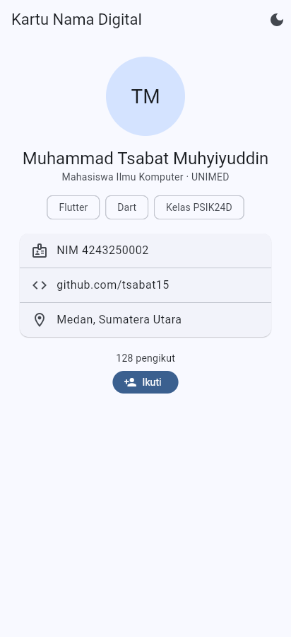
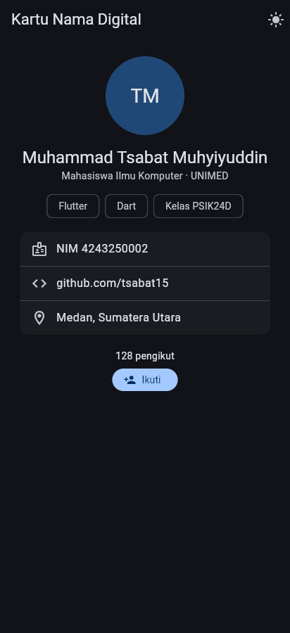

# Praktikum Pertemuan 5 — Kartu Nama Digital

Pemrograman Mobile (3KOM40215) · Pertemuan 5 · Ilmu Komputer UNIMED

| | |
|---|---|
| Nama  | Muhammad Tsabat Muhyiyuddin |
| NIM   | 4243250002 |
| Kelas | PSIK24D |
| GitHub | [tsabat15](https://github.com/tsabat15) |

## Cara menjalankan

```
flutter pub get
flutter run
flutter test
```

## Tampilan

Tangkapan layar diambil dari versi web di Chrome dengan lebar 412 px.

| Terang | Gelap |
|---|---|
|  |  |

## Tantangan yang dikerjakan

- **Tantangan 2:** `IconButton` di AppBar untuk berganti tema; `KartuNamaApp` menjadi Stateful dan mengatur `themeMode`.
- **Tantangan 3:** `ListTile` kontak dapat ditekan dan menampilkan SnackBar "Disalin".
- **Tantangan 4:** `TombolIkuti` dipindah ke `lib/widgets/tombol_ikuti.dart`.

Tantangan 1 (foto diri) belum dikerjakan karena memerlukan foto pribadi.

## Dokumen

Lembar Kerja Praktikum (C) dan Latihan Mandiri (E) ada di `dokumen/`.

## Pernyataan penggunaan AI

Saya menggunakan asisten AI untuk membantu menyalin dan menguji kode modul, mengerjakan tantangan, dan menyusun README ini. Saya bertanggung jawab memahami seluruh isinya.
